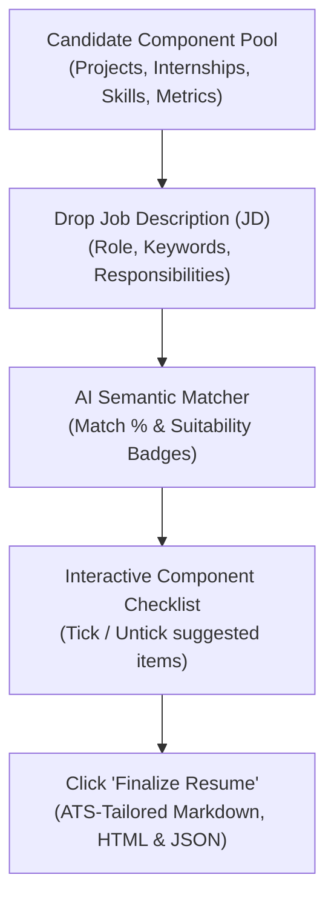

# 📄 AI Resume Optimization Agent

[](https://console.cron-job.org/jobs)
[](https://legion0069.github.io/Automation/)
[](https://github.com/legion0069/Ai-Resume-Customisation-for-jd/actions)
[](https://legion0069.github.io/Automation/)

> **Autonomous AI-Powered Resume Optimization Engine**: Ingests candidate component pools (projects, internship experiences, work history, technical skills), evaluates target Job Descriptions (JDs), computes semantic compatibility match scores, presents an interactive checklist for component selection, and finalizes tailored, high-converting ATS-optimized resumes.

---

## 🎯 How It Works: The 5-Step Workflow



1. **Candidate Component Pool**: Enter your raw master inventory of all completed projects, internships, leadership roles, metrics, and skill sets into the system.
2. **Drop Job Description (JD)**: Paste or drag-and-drop the target job posting. The NLP parser extracts target title, required vs. preferred skills, ATS keywords, and seniority level.
3. **AI Suitability Suggestions**: The engine scores each project and experience bullet against the JD, tagging items as `🔥 Highly Recommended` (>= 75%), `⭐ Strong Match` (50–74%), or `💡 Moderate / Optional`.
4. **Interactive Component Selection**: Review the ranked recommendations and tick/untick checkboxes to curate the exact set of projects and internships for this specific role.
5. **One-Click Finalize**: Click **"Finalize"** to synthesize a customized, ATS-compliant resume with a role-calibrated executive summary and tailored achievement bullets.

---

## ⏰ Daily Automation Schedule (cron-job.org)

To bypass GitHub Actions scheduling queue delays, this repository uses an external trigger configured via **[cron-job.org](https://console.cron-job.org/jobs)**:

- **Schedule**: **Daily at 10:30 AM IST (10:30 IST / 05:00 UTC)**
- **Target Endpoint**: `https://api.github.com/repos/legion0069/Ai-Resume-Customisation-for-jd/actions/workflows/daily-streak.yml/dispatches`
- **Method**: `POST`
- **Payload**: `{"ref": "main"}`
- **Frequency**: 4 commits executed daily across 30 days.

---

## 🗺️ 30-Day Master Milestone Roadmap

### Phase 1: Component Pool & Data Modeling (Days 1–5)
- [ ] **Day 1**: Project Setup, Component Architecture & Candidate Profile Schemas
- [ ] **Day 2**: Candidate Component Repository Engine & CRUD Store
- [ ] **Day 3**: Bullet-Point Action Verb & STAR Impact Metric Normalizer
- [ ] **Day 4**: Skills Taxonomy & Technical Hierarchy Engine
- [ ] **Day 5**: Candidate Profile Import/Export & Multi-Format Ingestion

### Phase 2: Job Description Analysis & Semantic Matcher (Days 6–10)
- [ ] **Day 6**: Job Description (JD) NLP Parser & Requirement Extractor
- [ ] **Day 7**: ATS Keyword Density & Technical Skill Matcher
- [ ] **Day 8**: Semantic Relevance & Component Compatibility Scoring Engine
- [ ] **Day 9**: Intelligent Project & Internship Recommendation Ranker
- [ ] **Day 10**: ATS Keyword Gap & Missing Skill Detection Engine

### Phase 3: Interactive Selection & Customization Engine (Days 11–16)
- [ ] **Day 11**: Interactive Component Checklist & State Management Engine
- [ ] **Day 12**: Resume Page-Budget & Line Density Calculator
- [ ] **Day 13**: Dynamic Section Priority & Layout Configurator
- [ ] **Day 14**: AI Executive Summary & Targeted Objective Generator
- [ ] **Day 15**: ATS Compatibility & Parser Compliance Pre-Flight Checker
- [ ] **Day 16**: Profile Pool vs. Tailored Resume Diff & Delta Inspector

### Phase 4: AI Bullet Tailoring & Optimization (Days 17–21)
- [ ] **Day 17**: Project & Experience Bullet-Point Rephraser
- [ ] **Day 18**: Quantifiable Metric & Business Impact Enhancer
- [ ] **Day 19**: Role-Specific Technical Acronym & Nomenclature Harmonizer
- [ ] **Day 20**: Tailored Cover Letter Synthesis Engine
- [ ] **Day 21**: Interview Prep & Resume Talking-Points Synthesizer

### Phase 5: Multi-Format Resume Rendering & Export (Days 22–26)
- [ ] **Day 22**: ATS-Compliant Markdown & Plaintext Resume Renderer
- [ ] **Day 23**: Responsive HTML/CSS Resume Template Engine
- [ ] **Day 24**: High-Fidelity Print-Ready PDF Styling & Paged Media Controller
- [ ] **Day 25**: JSON Resume Standard Exporter & Schema Validator
- [ ] **Day 26**: Multi-Target Resume Portfolio & Version Snapshot Manager

### Phase 6: Interactive Web UI, Testing & Release Packaging (Days 27–30)
- [ ] **Day 27**: Interactive Web Dashboard: Component Pool & JD Dropzone
- [ ] **Day 28**: Interactive Web Dashboard: Recommendation Deck & One-Click Finalizer
- [ ] **Day 29**: End-to-End System Integration & Multi-JD Benchmark Test Suite
- [ ] **Day 30**: Production Packaging, Comprehensive User Guide & v1.0.0 Release

---

## 🚀 Quick Start

### Installation
```bash
git clone https://github.com/legion0069/Ai-Resume-Customisation-for-jd.git
cd Ai-Resume-Customisation-for-jd
npm install
```

### Run Automated Workflow Demo
```bash
npm start
```

### Run Verification Test Suites
```bash
npm test
```

### Run Daily Streak Generator Manually
```bash
npm run streak
```

---

## 🏛️ Project Architecture

```
Ai-Resume-Customisation-for-jd/
├── .github/
│   └── workflows/
│       └── daily-streak.yml         # GitHub Actions workflow (10:30 AM IST)
├── .gitstreak/
│   └── state.json                   # 30-Day progress state & milestone tracker
├── docs/
│   ├── milestones/                  # Daily completion records
│   └── specs/                       # Architectural specifications
├── scripts/
│   └── streak-runner.js             # Autonomous 4-commit streak generator
├── src/
│   ├── models/
│   │   └── CandidateProfile.js      # Component schema (Projects, Internships, Skills)
│   ├── parser/
│   │   └── JobDescriptionParser.js  # NLP keyword, title & requirement extractor
│   ├── engine/
│   │   └── SemanticMatcher.js       # Match scoring & suitability algorithm
│   ├── optimizer/
│   │   └── ResumeOptimizer.js       # Selection state & tailored synthesis
│   ├── generator/
│   │   └── ResumeRenderer.js        # ATS Markdown, HTML & JSON exports
│   └── cli.js                       # Interactive CLI demonstration
├── tests/
│   └── resumeOptimizer.test.js      # Automated unit & integration tests
├── package.json
└── README.md
```

---

## 📜 License
Licensed under the [MIT License](LICENSE).

